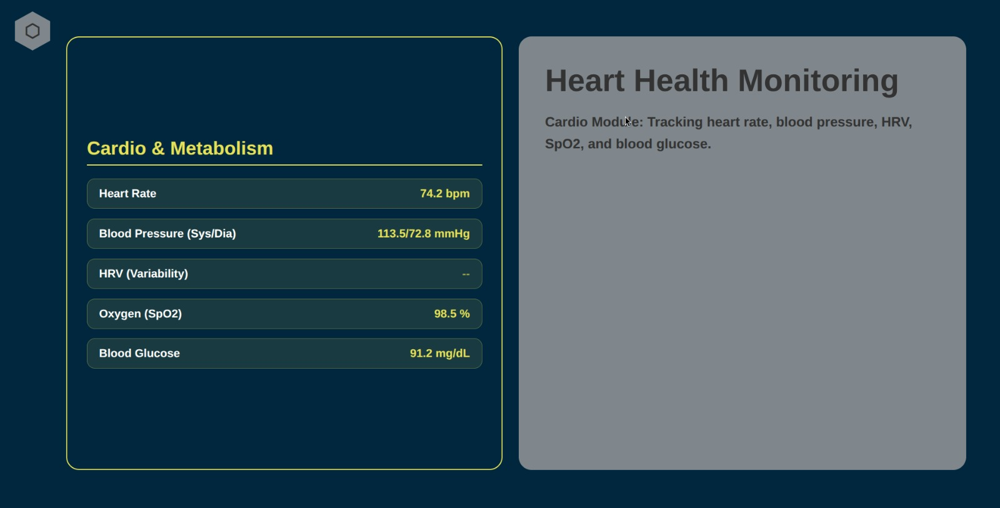
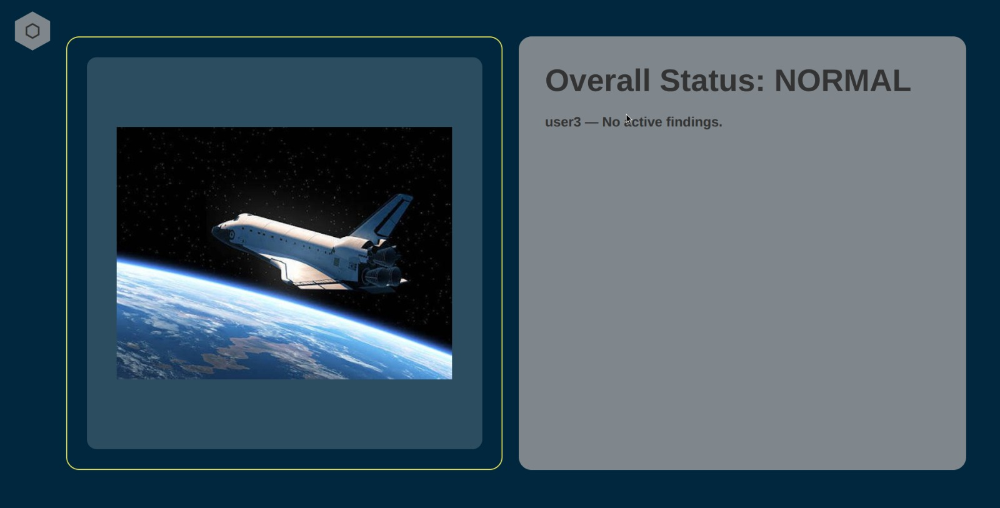
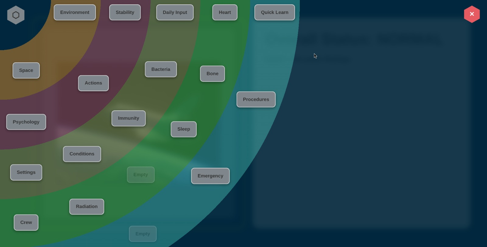

# PULSE - Astronaut Health Monitoring Software For Space Missions (2026 NASA Space Apps Challange)

## Project Overview and Technical Documentation

This document describes the Astronaut Health Monitoring project, including its original goals, architectural decisions, development history, simulation engine, health condition evaluation system, and data sources.

It is intended to serve as both a GitHub README and a foundation for a more detailed GitHub Wiki.

The project is an educational simulation and monitoring backend designed around the context of astronauts aboard the International Space Station (ISS).

It generates synthetic physiological data, evaluates that data using rule-based logic, integrates external space-related data sources, and exposes the resulting information through a REST API.

**This project is not a clinical medical system. It does not diagnose medical conditions, replace medical professionals, or provide validated medical advice.** All physiological measurements and health findings generated by the simulation are synthetic.







## Further Read:
- [NASA Space Apps Challange Team Project Page](https://www.spaceappschallenge.org/2026/find-a-team/garage/?tab=project)
- [Backend -> Frontend API Documentation](api_v0.4.0.md)
- [Brief Presentation](eefndljvnf.pdf)
- [RedLab NASA API Documentation](https://visualization.osdr.nasa.gov/radlab/gui/data-api/)
- [NASA DONKI API](https://api.nasa.gov)
- [Open-Notify API Documentation](https://open-notify.org/Open-Notify-API/ISS-Location-Now/)
- [Risks of Human Spaceflight](https://www.nasa.gov/hrp/risks/)
- [5 Hazards of Human Spaceflight](https://www.nasa.gov/hrp/hazards/)

---

# 1. Project Purpose and Background

The main idea behind this project is to explore how astronauts' physiological conditions could be monitored during space missions.

Monitoring an astronaut's health requires more than observing a single measurement. Multiple physiological parameters must be considered together, including:

- Heart rate
- Blood pressure
- Body temperature
- Blood oxygen saturation
- Respiratory rate
- Blood glucose
- Heart rate variability

For example:

- Heart rate may be normal while SpO₂ is low.
- Blood pressure may be elevated while heart rate remains normal.
- A measurement may appear normal but still be unreliable because it is outdated, missing, or invalid.
- Multiple abnormalities may occur simultaneously in the same astronaut.
- Physiological measurements should behave differently depending on whether the astronaut is resting, sleeping, or exercising.

Therefore, the goal was not simply to generate random numbers.

The goal was to build a simulation capable of producing time-dependent, interconnected synthetic physiological measurements under different scenarios, and then independently evaluating those measurements.

## 1.1. Core Project Objectives

The following requirements shaped the project:

1. The system must support multiple astronauts.
2. Each astronaut must maintain an independent physiological state.
3. Astronaut profiles and simulation scenarios must be managed independently.
4. ISS cabin environmental data and space-related data must be shared.
5. Physiological measurements must evolve over time.
6. Multiple abnormalities must be able to occur simultaneously.
7. Health conditions must be detected from actual measurement values rather than scenario names.
8. Missing, invalid, and outdated measurements must be identified separately.
9. Synthetic ECG data must be generated.
10. Results must be exposed through a REST API for frontend applications.
11. Multiple astronauts must be evaluated independently.
12. External real-world data sources must remain distinguishable from synthetic measurements.
13. The system must not make medical diagnoses; it should only report observed conditions and relevant information.

These requirements directly influenced the system architecture.

---

# 2. Core Architectural Decision: Separating Simulation, Evaluation, and API Layers

One of the most important architectural decisions was avoiding a single Python file responsible for every operation.

Instead, the system was divided into three primary modules:

```text
                 ┌──────────────────────────┐
                 │       shuffler.py        │
                 │                          │
                 │   Data Generation Layer  │
                 │                          │
                 │  - Physiological data    │
                 │  - ECG generation        │
                 │  - Astronaut states      │
                 │  - External data sources │
                 └────────────┬─────────────┘
                              │
                              ▼
                 ┌──────────────────────────┐
                 │   condition_engine.py    │
                 │                          │
                 │     Evaluation Layer     │
                 │                          │
                 │  - Measurement validation│
                 │  - Data quality          │
                 │  - Condition evaluation  │
                 │  - Finding generation    │
                 └────────────┬─────────────┘
                              │
                              ▼
                 ┌──────────────────────────┐
                 │         main.py          │
                 │                          │
                 │    API / Integration     │
                 │                          │
                 │  - FastAPI               │
                 │  - Shared data refresh   │
                 │  - Astronaut management  │
                 │  - API responses         │
                 └────────────┬─────────────┘
                              │
                              ▼
                 ┌──────────────────────────┐
                 │   Frontend / API Clients │
                 │                          │
                 │  - Dashboard             │
                 │  - Charts                │
                 │  - Alerts                │
                 │  - Telemetry             │
                 │  - ECG visualization    │
                 └──────────────────────────┘
```

This separation provides an important advantage: modifying the simulation logic does not require rewriting the evaluation engine. Similarly, changing API response structures does not require modifying the physiological simulation itself.

## 2.1. `shuffler.py` — Data Generation Layer

This module is responsible for:

- Simulating astronauts' physiological states.
- Maintaining independent states for each astronaut.
- Applying normal and abnormal scenarios.
- Generating measurement timestamps.
- Producing synthetic ECG samples.
- Retrieving ISS position data.
- Retrieving space weather information through NASA DONKI.
- Retrieving historical radiation data through NASA OSDR RadLab.
- Calculating radiation dose estimates.
- Generating shared environmental data and astronaut snapshots.

This module acts as the system's data source.

However, it is not responsible for determining whether a measurement represents a health condition.

## 2.2. `condition_engine.py` — Evaluation Layer

This module is responsible for:

- Inspecting incoming measurements.
- Validating measurement values.
- Checking measurement freshness.
- Evaluating physiological conditions using predefined rules.
- Generating multiple findings when necessary.
- Assigning severity information and descriptions.
- Determining the overall status.

An important architectural principle was established here:

**The evaluation engine must not determine a condition simply because a particular simulation scenario is active.**

For example, even if the `HYPERGLYCEMIA` scenario is enabled in `shuffler.py`, the evaluation engine must independently inspect the blood glucose measurement before generating a hyperglycemia finding.

This keeps the simulation and evaluation systems independent.

## 2.3. `main.py` — API and Integration Layer

This module connects the other two components.

Its responsibilities include:

- Starting the FastAPI application.
- Managing the shared data refresh cycle.
- Generating and evaluating astronaut snapshots.
- Storing the latest results in memory.
- Exposing API endpoints.
- Managing simulation scenario changes.
- Tracking alert verification and acknowledgment.
- Managing astronaut logs.
- Validating incoming API requests.

`main.py` is not a health evaluation engine. It is the integration layer that makes generated data and evaluation results accessible through an API.

---

# 3. Project Development History and Version Evolution

The project was not developed in a single step.

It initially started as a single-astronaut data simulation and gradually evolved into a system containing a health evaluation engine, multi-astronaut support, NASA data integrations, and an API layer.

The following timeline combines the development decisions discussed during the project with the features confirmed in the latest source files.

Since not every intermediate source version is available, individual changes are not assigned to version numbers unless they can be established reliably.

## 3.1. Initial Stage — Synthetic Physiological Data Generation

The initial development focused on `shuffler.py`.

The first objective was to create a simulation capable of generating physiological measurements for an astronaut.

However, measurements should not change randomly and abruptly every time the simulation updates.

For example, a heart rate changing from 68 bpm to 130 bpm within a single second would not produce a particularly realistic simulation.

Instead, measurements needed to transition gradually.

To achieve this, the simulation uses time-dependent smoothing.

One of the core functions used for this purpose is:

```python
def smooth_value(current, target, dt, time_constant):
    if dt <= 0:
        return current

    alpha = 1.0 - math.exp(-dt / time_constant)

    return current + (target - current) * alpha
```

This approach gradually moves the current value toward a target value based on elapsed time.

Parameters:

- `current`: The current measurement value.
- `target`: The desired target value.
- `dt`: Elapsed time.
- `time_constant`: Controls how quickly the value approaches its target.

This produces smoother and more continuous simulation behavior.

## 3.2. Development of the Scenario System

Initially, generating normal and abnormal measurements seemed sufficient.

However, for testing purposes, the `ABNORMAL` state needed to be divided into more specific scenarios.

For example:

- A hyperglycemia scenario should primarily affect blood glucose.
- A tachycardia scenario should affect heart rate.
- A hypothermia scenario should affect body temperature.

As a result, the simulation modes were expanded:

| Mode | Description |
|---|---|
| `NORMAL` | Normal daily physiological simulation |
| `REST` | Resting state |
| `EXERCISE` | Exercise state |
| `SLEEP` | Sleep state |
| `ABNORMAL` | Selected abnormality simulation |

`REST`, `EXERCISE`, and `SLEEP` are activity states rather than diseases or medical abnormalities.

They influence physiological behavior under different simulated activity conditions.

`ABNORMAL`, on the other hand, applies specific target values to selected physiological measurements.

## 3.3. Measurement Timestamps and Data Quality

Another important development was introducing the `measured_at` field for measurements.

The reason is straightforward: a measurement value alone is insufficient. The system also needs to know when that measurement was generated.

For example:

```json
{
  "heart_rate": 112.0,
  "measurement_metadata": {
    "heart_rate": {
      "unit": "bpm",
      "measured_at": "2026-11-15T12:30:00+00:00"
    }
  }
}
```

This makes it possible to determine whether a measurement is still fresh.

Consequently, `condition_engine.py` began evaluating not only numerical values but also their timestamps.

This decision later became the foundation of the measurement data quality system.

## 3.4. v1.3.0 — Multiple Abnormalities and More Realistic Scenarios

During the earlier development stages, the following features were discussed and incorporated into `shuffler.py` around version v1.3.0:

- `NORMAL`, `REST`, `EXERCISE`, `SLEEP`, and `ABNORMAL` modes.
- Support for multiple simultaneous abnormalities.
- Measurement-specific metadata and timestamps.
- Controlled and realistic abnormal target ranges.
- Separation of historical RadLab data from live telemetry.

An important decision was that abnormal scenarios should generate controlled values resembling physiological measurements rather than arbitrary extreme numbers.

For example, the hyperglycemia simulation uses a controlled range instead of unnecessarily extreme values such as 500 mg/dL.

## 3.5. v2.0.0 — Multi-Astronaut Architecture

This was one of the largest architectural changes in the project.

The system was no longer intended to simulate only one astronaut.

Three astronauts were introduced:

```python
ASTRONAUT_IDS = ("user1", "user2", "user3")
```

Each astronaut maintains independent:

- Physiological state.
- Profile.
- Simulation mode.
- Active abnormalities.
- Measurement metadata.
- Measurement publication timestamps.
- ECG phase.

However, the following information is shared:

- ISS cabin environment.
- ISS position.
- NASA DONKI space weather information.
- NASA OSDR RadLab radiation archive.

This distinction is essential.

All three astronauts are assumed to occupy the same ISS environment, but their physiological conditions can differ independently.

For example:

```text
user1: NORMAL
user2: EXERCISE
user3: ABNORMAL — TACHYCARDIA
```

In this scenario, all three astronauts share the same ISS position and cabin environment, while their physiological measurements are calculated independently.

### 3.5.1. Backward Compatibility

During the transition to the multi-astronaut architecture, we also aimed to avoid unnecessarily breaking older single-user code.

Legacy compatibility variables and functions were retained for `user1`.

For example:

```python
ASTRONAUT_PROFILE = ASTRONAUT_PROFILES["user1"]
```

This approach helps prevent older code from becoming unusable immediately after the architectural change.

## 3.6. Introduction of the API Layer

The next major stage involved developing `main.py`.

The initial API design focused on basic endpoints such as:

- Dashboard
- Conditions
- Telemetry
- ECG

The early architecture already included a shared snapshot and a two-second refresh cycle.

As the multi-astronaut architecture developed, the API was expanded to include:

- Astronaut-specific endpoints.
- Crew overview.
- Shared environmental and space data.
- Simulation scenario management.
- Alert verification and acknowledgment.
- Astronaut activity logs.

The API contract evolved from the initial v0.1 drafts to API v0.4.0.

## 3.7. Current State — `shuffler.py` v2.1.0 and API v0.4.0

The versions identified in the latest source files are:

| Module | Version |
|---|---:|
| `shuffler.py` | 2.1.0 |
| `condition_engine.py` | No separate version constant |
| `main.py` | API 0.4.0 |

Version v2.1.0 introduced or incorporated important improvements involving:

- Preservation of abnormal scenario target values.
- ECG cardiac arrest state transitions.
- Timestamp validation.
- RadLab timestamp deduplication and cache management.
- HTTP retry handling.

The latest code review also identified and corrected issues affecting API alert verification and asynchronous execution.

These changes are explained in later sections.

---

# 4. `shuffler.py` — Synthetic Data Generation System

This module is the project's data generation engine.

The current source identifies `shuffler.py` as version v2.1.0 and uses only the Python standard library.

The primary standard library modules include:

- `json`
- `math`
- `random`
- `threading`
- `time`
- `copy`
- `datetime`
- `urllib`

Simulation, HTTP requests, time management, and concurrency operations are implemented without introducing additional third-party packages.

## 4.1. Astronaut Identifiers

The system currently defines three astronauts:

```python
ASTRONAUT_IDS = ("user1", "user2", "user3")
```

These are simulation identifiers rather than real-world identities.

Each astronaut's state is maintained independently inside the `_astronauts` dictionary.

A simplified example:

```python
_astronauts = {
    "user1": {
        "profile": {...},
        "mode": "NORMAL",
        "active_abnormalities": (),
        "state": {...},
        "physiological_data": {},
        "measurement_metadata": {},
        "last_publish": {},
        "ecg_phase": 0.0,
    }
}
```

The actual source initializes this structure for all three astronauts.

The important detail is that each astronaut receives independent initial state data.

Changing one astronaut's scenario does not modify another astronaut's physiological state.

## 4.2. Astronaut Profiles

Each astronaut has an initial simulation profile.

The default profile is:

```python
DEFAULT_ASTRONAUT_PROFILE = {
    "body_mass": 75.0,
    "resting_hr": 68.0,
    "baseline_hrv": 65.0,
    "baseline_skin_temp": 34.5,
}
```

| Field | Description | Unit |
|---|---|---|
| `body_mass` | Astronaut's simulated body mass | kg |
| `resting_hr` | Resting heart rate | bpm |
| `baseline_hrv` | Baseline heart rate variability | ms |
| `baseline_skin_temp` | Baseline skin temperature | °C |

Profile values are validated.

For example:

- Body mass must be between 20 and 300 kg.
- Resting heart rate must be between 40 and 100 bpm.
- HRV must be between 10 and 200 ms.
- Baseline skin temperature must be between 25 and 38 °C.

These are simulation configuration constraints, not clinical reference ranges.

The `set_astronaut_profile()` function updates an astronaut's profile.

The `get_astronaut_profile()` function returns a copy of the relevant profile.

Updating a profile does not reset the astronaut's existing physiological state. New profile parameters take effect during subsequent simulation updates.

## 4.3. Simulated Physiological Measurements

`shuffler.py` generates multiple physiological measurements.

| Measurement | Field | Unit |
|---|---|---|
| Heart rate | `heart_rate` | bpm |
| Systolic blood pressure | `systolic_bp` | mmHg |
| Diastolic blood pressure | `diastolic_bp` | mmHg |
| Heart rate variability | `heart_rate_variability` | ms |
| Respiratory rate | `respiratory_rate` | breaths/min |
| Oxygen saturation | `spo2` | % |
| Body temperature | `body_temperature` | °C |
| Skin temperature | `skin_temperature` | °C |
| Blood glucose | `blood_glucose` | mg/dL |
| Stress level | `stress_level` | index |
| Sleep duration | `sleep_duration` | h |
| Sleep quality | `sleep_quality` | index |
| Physical activity | `physical_activity` | simulation_index |
| Body mass | `body_mass` | kg |
| Hydration level | `hydration_level` | index |

Not all these measurements are directly interpretable in a clinical context.

For example:

- HRV is not calculated using a formally specified SDNN or RMSSD method.
- Blood glucose simulation does not model meal timing or fasting status.
- Stress, sleep quality, and hydration values are synthetic indices.
- Physical activity is not expressed in METs.

For this reason, some measurements use the metadata field:

```json
{
  "interpretation_ready": false
}
```

This allows the frontend and evaluation layer to understand the limitations of individual measurements.

## 4.4. Measurement Update Intervals

Not every measurement needs to be updated at the same frequency.

The system therefore uses an `UPDATE_INTERVALS` dictionary.

Examples:

| Measurement | Update interval |
|---|---:|
| Heart rate | 1 second |
| Respiratory rate | 1 second |
| SpO₂ | 2 seconds |
| Body temperature | 10 seconds |
| Blood glucose | 60 seconds |
| Blood pressure | 60 seconds |
| HRV | 60 seconds |
| Sleep duration | 60 seconds |
| Body mass | 3600 seconds |

This prevents unnecessary changes to every measurement on every API refresh.

For example, heart rate is updated more frequently, while body mass is published at hourly intervals.

## 4.5. Physiological Effects of Simulation Modes

Activity modes influence physiological target values.

For example, the physical activity targets are:

| Mode | Activity target |
|---|---:|
| NORMAL | 5.0 |
| REST | 1.5 |
| EXERCISE | 16.0 |
| SLEEP | 0.5 |
| ABNORMAL | 5.0 |

These values represent simulation indices.

Heart rate, stress, respiratory rate, and other measurements are influenced by the activity level.

This allows the simulation to represent behaviors such as increased heart rate during exercise and reduced activity during sleep.

This is a simplified physiological simulation, not a model trained on real astronaut data or clinically validated physiological observations.

## 4.6. Abnormality Scenarios

The current `SUPPORTED_ABNORMALITIES` collection defines 12 scenarios.

| Scenario | Affected measurement | Simulation target |
|---|---|---:|
| `HYPERGLYCEMIA` | Blood glucose | 145–170 mg/dL |
| `HYPOGLYCEMIA` | Blood glucose | 65–69 mg/dL |
| `TACHYCARDIA` | Heart rate | 105–115 bpm |
| `BRADYCARDIA` | Heart rate | 48–55 bpm |
| `HYPOTHERMIA` | Body temperature | 34.2–34.8 °C |
| `FEVER` | Body temperature | 37.8–38.3 °C |
| `HYPOXEMIA` | SpO₂ | 92–94% |
| `SEVERE_HYPOXEMIA` | SpO₂, respiratory rate | 65%, 28/min |
| `CARDIAC_ARREST` | Heart rate | 0 bpm |
| `TACHYPNEA` | Respiratory rate | 22–25/min |
| `HYPERTENSION` | Systolic/diastolic pressure | 130–145 / 80–90 mmHg |
| `HYPOTENSION` | Systolic/diastolic pressure | 90–99 / 55–64 mmHg |

These values are simulation targets for testing purposes. They must not be interpreted as clinical diagnostic or treatment thresholds.

### 4.6.1. Simultaneous Abnormality Scenarios

The system supports multiple compatible abnormalities within the same astronaut.

For example:

```json
{
  "mode": "ABNORMAL",
  "abnormalities": [
    "HYPERGLYCEMIA",
    "TACHYCARDIA",
    "FEVER"
  ]
}
```

In this scenario:

- Blood glucose increases.
- Heart rate increases.
- Body temperature increases.

Each abnormality applies its own target values.

### 4.6.2. Conflicting Scenarios

Some abnormalities affect the same measurement in opposite directions. Combining these scenarios would not produce a meaningful simulation.

Therefore, conflict validation was implemented.

Examples include:

- `HYPERGLYCEMIA` and `HYPOGLYCEMIA`
- `TACHYCARDIA` and `BRADYCARDIA`
- `HYPOTHERMIA` and `FEVER`
- `HYPERTENSION` and `HYPOTENSION`
- `HYPOXEMIA` and `SEVERE_HYPOXEMIA`
- `CARDIAC_ARREST` and `TACHYCARDIA`
- `CARDIAC_ARREST` and `BRADYCARDIA`

These combinations raise a `ValueError`.

Additional validation rules include:

- At least one abnormality must be selected when using `ABNORMAL` mode.
- Abnormality lists must not be supplied for other modes.
- Unknown scenario names are rejected.
- Duplicate abnormalities are not accepted.

### 4.6.3. Preserving Scenario Target Values

During the final source code review, an important simulation issue was identified.

The normal physiological model could overwrite abnormal scenario targets and gradually smooth measurements back toward normal values.

This prevented abnormality tests from remaining consistent.

The issue was corrected by reapplying configured scenario targets after the normal physiological update.

The first snapshot now also reflects the configured abnormality targets immediately.

For example, after enabling the tachycardia scenario, the first snapshot no longer incorrectly reports a normal heart rate.

## 4.7. ECG Generation

The system can generate independent synthetic ECG samples for each astronaut.

Sampling frequency:

**500 Hz**

This means 500 samples per second.

The `get_ecg_samples()` function accepts parameters such as:

```python
get_ecg_samples(
    sample_count=25,
    astronaut_id="user1",
)
```

The sample count is restricted to the range of 1–5000.

The generated ECG signal:

- Is synthetic.
- Uses millivolts (mV).
- Is influenced by the astronaut's heart rate.
- Maintains independent phase information for each astronaut.
- Is intended for visualization purposes.

In the `CARDIAC_ARREST` scenario, the signal is reset and a flat line is generated:

```python
return [0.0] * sample_count
```

This ECG output is not equivalent to a clinical ECG device recording and must not be used for medical diagnosis.

## 4.8. Shared ISS Cabin Environment

Since all three astronauts are assumed to occupy the same cabin, environmental measurements are shared.

Initial environmental fields include:

| Field | Unit |
|---|---|
| `cabin_temperature` | °C |
| `cabin_pressure` | kPa |
| `cabin_humidity` | % |
| `cabin_oxygen` | % |
| `cabin_co2` | ppm |
| `microgravity_level` | simulation_index |
| `cabin_air_quality` | index |

An important distinction: these are simulated cabin environmental values. They are not live measurements retrieved from actual ISS cabin sensors.

ISS position and NASA data are retrieved through separate sources.

## 4.9. ISS Position Data

The system uses the following source for ISS position information:

`api.wheretheiss.at`

The code attempts to retrieve:

- Latitude
- Longitude
- Altitude
- Velocity
- Visibility information
- Measurement timestamp

The data structure also includes:

- `status`
- `last_api_update`
- `last_error`

These fields make it possible to determine whether the external service is functioning and whether the stored data is current.

When requests fail, the retry interval is increased to avoid repeatedly sending requests to an unavailable service.

## 4.10. NASA DONKI — Space Weather

NASA DONKI is used to provide space weather context.

The code queries three event types:

| Abbreviation | Description |
|---|---|
| `SEP` | Solar Energetic Particle events |
| `CME` | Coronal Mass Ejection events |
| `GST` | Geomagnetic Storm events |

Data is retrieved through the NASA API.

The API key is not hardcoded into the source code. Instead, it is loaded from an `api_keys.json` file.

If the key is unavailable, the following status is used:

```text
DISABLED_NO_API_KEY
```

This is an important design choice: missing API credentials disable the relevant external data source without causing the entire backend to crash.

DONKI requests are configured to run at 15-minute intervals and cover the previous seven days.

## 4.11. NASA OSDR RadLab — Radiation Data

An important distinction was established when integrating this data source.

NASA OSDR RadLab data is not live astronaut dosimeter telemetry.

The system uses this source to retrieve historical radiation measurements associated with the ISS.

This distinction is explicitly represented in the data contract:

```text
HISTORICAL_ARCHIVE_NOT_LIVE_TELEMETRY
```

This prevents frontend applications and other clients from presenting RadLab measurements as real-time astronaut radiation exposure.

RadLab provides dose-rate measurements in `µSv/hour`.

The system estimates cumulative dose using the time interval between two measurements and their respective dose rates.

The calculation uses the trapezoidal integration method:

\[
\Delta D =
\frac{R_1 + R_2}{2}
\times
\frac{\Delta t}{3600}
\]

Where:

- \(R_1\): Previous dose rate (µSv/hour)
- \(R_2\): Current dose rate (µSv/hour)
- \(\Delta t\): Time between measurements (seconds)
- \(\Delta D\): Estimated dose increment (µSv)

The cumulative dose is then accumulated, and an mSv equivalent is also calculated.

The system tracks measurement timestamps to prevent duplicate records from being integrated more than once.

To prevent indefinite memory growth during long-running sessions, old timestamp entries are removed from the deduplication cache.

If the interval between two measurements exceeds the configured maximum, dose integration is skipped for that interval.

This prevents long and uncertain data gaps from being incorrectly interpreted as continuous radiation exposure.

**Important:** This calculation mathematically processes historical records within the selected integration window. It does not represent the actual total radiation dose received by an astronaut throughout a real mission.

## 4.12. Snapshot Architecture

Instead of exposing every measurement through unrelated functions, `shuffler.py` combines the generated data into snapshot structures.

An astronaut snapshot contains the following main sections:

```json
{
  "astronaut_id": "user1",
  "physiological_data": {},
  "environmental_data": {},
  "system_data": {},
  "iss_position_data": {},
  "space_weather_data": {},
  "radiation_dosimetry_data": {},
  "measurement_metadata": {}
}
```

This snapshot is the primary data object used throughout the project.

`generate_all_snapshots()` generates snapshots for all astronauts.

`generate_snapshot()` returns the snapshot for a specific astronaut, while using the shared team and environment update logic internally.

This design prevents the system from downloading shared ISS and NASA data separately for every astronaut.

---

# 5. `condition_engine.py` — Health Condition Evaluation

This module is the decision-making layer of the project.

Its purpose is to inspect measurements inside a snapshot and generate synthetic findings according to predefined rules.

The following principles were maintained:

- Scenario labels are not used as evaluation results.
- Measurement values and data quality are checked.
- Invalid or outdated measurements do not generate reliable health findings.
- Multiple findings can be returned simultaneously.
- The evaluation function is stateless.

## 5.1. Stateless Evaluation

The `evaluate_conditions(snapshot)` function evaluates only the snapshot provided to it.

It does not maintain previous astronaut evaluations internally.

Advantages include:

- Astronauts cannot affect one another's evaluation results.
- The same snapshot is evaluated using the same rules.
- The evaluation engine can be tested independently of the API layer.
- Scenario management and finding generation remain separate.

## 5.2. Measurement Data Quality

Each measurement can have one of five quality states.

| Quality | Meaning |
|---|---|
| `VALID` | Measurement is valid and sufficiently recent |
| `MISSING` | Measurement is unavailable |
| `INVALID` | Measurement value or timestamp is invalid |
| `STALE` | Measurement exceeds its permitted age |
| `UNKNOWN` | Measurement exists, but its timestamp cannot be interpreted reliably |

This distinction is an important part of the system.

For example, a heart rate of `0` is a valid numerical value.

However, if its measurement timestamp is missing, the system cannot determine whether that value is current.

Therefore, a measurement with `UNKNOWN` quality is not used to generate a reliable health finding.

### 5.2.1. Measurement Age Limits

The current evaluation engine uses the following maximum measurement ages:

| Measurement | Maximum age |
|---|---:|
| Heart rate | 5 seconds |
| Systolic blood pressure | 180 seconds |
| Diastolic blood pressure | 180 seconds |
| Blood glucose | 180 seconds |
| Body temperature | 30 seconds |
| SpO₂ | 10 seconds |
| Respiratory rate | 5 seconds |

These are simulation data freshness rules, not clinical measurement standards.

A small tolerance is also allowed for future timestamps. Timestamps more than five seconds ahead of the current time are considered invalid.

## 5.3. Measurement Validation Process

The `validate_measurement()` function checks:

1. Whether the measurement exists.
2. Whether the value is numeric.
3. Whether the value is an invalid numeric type, such as a boolean.
4. Whether the value contains `NaN` or infinity.
5. Whether the `measured_at` timestamp can be parsed.
6. Whether the timestamp is sufficiently recent.

For example:

```python
result = validate_measurement(
    snapshot,
    "heart_rate",
)
```

The resulting structure can contain the measurement quality, value, timestamp, and age.

## 5.4. Defined Evaluation Rules

The current `CONDITION_RULES` configuration contains 11 evaluation conditions:

- `HYPERGLYCEMIA`
- `HYPOGLYCEMIA`
- `TACHYCARDIA`
- `BRADYCARDIA`
- `CARDIAC_ARREST`
- `HYPOTHERMIA`
- `FEVER`
- `HYPOXEMIA`
- `TACHYPNEA`
- `HYPERTENSION`
- `HYPOTENSION`

Notice that the simulation defines 12 abnormalities, while the evaluation engine defines 11 separate condition rules.

There is no separate `SEVERE_HYPOXEMIA` rule in the evaluation engine.

This is because severe hypoxemia is not a separate measurement type. It is a more severe state of the existing hypoxemia condition.

For example:

- `SEVERE_HYPOXEMIA` is selected in the simulation.
- The simulation generates an SpO₂ value of 65.
- The evaluation engine independently detects `HYPOXEMIA`.
- The finding receives `CRITICAL` severity.
- The `life_threatening_candidate` field is activated.

This is a good example of why the simulation and evaluation systems must remain independent.

## 5.5. Blood Pressure Evaluation

Blood pressure consists of two measurements:

- Systolic pressure
- Diastolic pressure

Both values are not required to be valid for every evaluation.

For example, systolic pressure may be valid while diastolic pressure is missing. In that case, the valid systolic measurement may still be sufficient to generate a finding.

The hypertension rule uses:

- Systolic ≥ 130 mmHg
- OR diastolic ≥ 80 mmHg

Either condition is sufficient.

The hypotension rule uses:

- Systolic ≤ 99 mmHg
- OR diastolic ≤ 64 mmHg

Again, either condition is sufficient.

These values are simulation rules and must not be interpreted as clinical diagnostic thresholds.

## 5.6. Hypoxemia Evaluation

Hypoxemia evaluation is primarily based on the SpO₂ measurement.

Respiratory rate is used as a supporting measurement but is not mandatory.

- SpO₂ above 94 does not generate a hypoxemia finding.
- SpO₂ at or below 94 may generate a hypoxemia finding.
- Respiratory rate at or above 22 provides a supporting factor.
- SpO₂ below 70 activates the life-threatening candidate flag.

Severe hypoxemia and cardiac arrest are two conditions that can enter the system's special alert verification process.

## 5.7. Finding Severity Levels

The evaluation engine uses the following status levels:

| Status | Meaning |
|---|---|
| `NORMAL` | No active abnormality detected and required data is sufficiently complete |
| `CAUTION` | Measurement quality issues or a lower-severity finding |
| `WARNING` | A more serious synthetic finding |
| `CRITICAL` | A condition classified as critical by the simulation rules |

The cardiac arrest scenario is classified as `CRITICAL`.

Severe hypoxemia with SpO₂ below 70 is also classified as `CRITICAL`.

If SpO₂ is at or below 92 and respiratory rate is elevated, hypoxemia is assigned `WARNING` severity.

Other defined findings use `CAUTION` severity by default.

## 5.8. Determining the Overall Status

`overall_status` is determined by evaluating active findings and measurement data quality together.

An important correction was made during the final code review: the system no longer automatically reports `NORMAL` when any required measurement is missing, invalid, stale, or has an unknown timestamp.

For example:

- Heart rate is valid.
- SpO₂ is valid.
- Blood glucose is missing.
- Respiratory rate is valid.

If there are no other active findings, the overall status becomes `CAUTION`.

However, if the same snapshot contains a `CRITICAL` finding, the higher severity level is preserved.

This design prevents incomplete telemetry from creating a false sense of safety.

## 5.9. Interpretation Limitations

Some measurements require additional context before they can be meaningfully interpreted.

For example, blood glucose interpretation may depend on:

- Time of the last meal.
- Whether the astronaut is fasting.
- Time elapsed since eating.

The current simulation does not model these factors.

Therefore, blood glucose findings include fields such as:

```json
{
  "interpretation_limited": true,
  "context_note": "..."
}
```

Similarly, HRV, stress, hydration, and certain environmental indices are not directly suitable for clinical interpretation.

Explicitly exposing these limitations through metadata helps prevent incorrect interpretations of the simulation output.

## 5.10. Evaluation Output

The `evaluate_conditions()` function returns a structure similar to:

```json
{
  "overall_status": "CAUTION",
  "active_conditions": [],
  "data_quality": {},
  "evaluated_at": "2026-11-15T12:30:00+00:00"
}
```

Each active finding can contain fields such as:

- `id`
- `status`
- `title`
- `description`
- `observed_value`
- `unit`
- `measured_at`
- `quality`
- `life_threatening_candidate`
- `recommendations`
- `related_measurements`

In the current source code, `recommendations` is returned as an empty list.

This means that although the response structure already supports actionable recommendations, condition-specific automatic recommendation messages have not yet been implemented.

This distinction is important: the existence of the field does not mean that the recommendation engine is complete.

# 6. Who Are We?

Hello! We're 2 high schoolers from Türkiye who wants to make our world a better place to live, and to improve human welfare. We're looking straight to be part of the innovators in the world, compete with other innovators and be best among them. Thanks for your support!

# 7. License

This project is licensed with - [Apache 2.0 License](LICENSE)